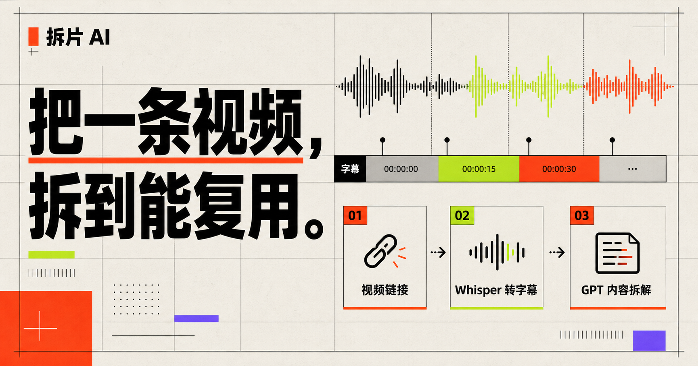
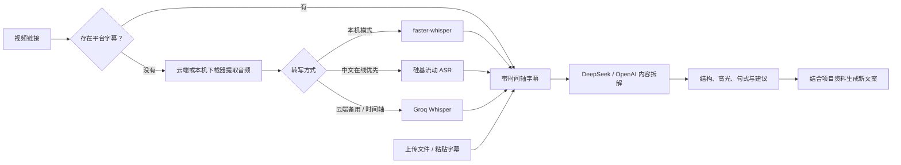

# 拆片 AI

> 把一条视频，拆成能复用的内容资产。

[](LICENSE)


[在线体验](https://jackshaw.top) · [产品路线图](ROADMAP.md) · [参与贡献](CONTRIBUTING.md) · [安全策略](SECURITY.md)

拆片 AI 是一个面向中文创作者与营销团队的本地优先视频内容工作台。它可以从视频链接、上传文件或已有字幕开始，完成语音转写、内容架构拆解、高光表达提取、可复用句式整理，并结合项目信息生成新的短视频、小红书、私域或广告文案。



## 为什么做这个项目

普通转写工具只解决“视频说了什么”，拆片 AI 继续解决三个问题：

1. 这段内容为什么有效；
2. 哪些结构、表达和句式可以复用；
3. 如何结合自己的项目资料生成新内容。

本地模式强调隐私和低成本，在线模式强调开箱即用。两种模式可以在同一页面切换。

## 核心能力

- **三种输入**：视频或音频链接、上传音视频、直接粘贴字幕；
- **字幕优先**：链接先读取 YouTube、哔哩哔哩或网页内嵌字幕，找不到时再提取音频；
- **三种转写**：硅基流动 ASR、Groq Whisper，以及本机 faster-whisper；
- **自动降级**：硅基流动服务异常时，可自动切换到 Groq 完成在线转写；
- **内容拆解**：摘要、评分、内容公式、开场机制、转化路径、结构、高光表达、可复用句式和优化建议；
- **项目仿写**：结合项目资料生成短视频口播、小红书、私域和广告文案；
- **一键复用**：复制字幕、报告与句式，下载 SRT；
- **本地优先**：媒体可以只在电脑内处理，API 密钥不写入浏览器存储；
- **公开体验保护**：访客日额度、短时频率限制和全站每日上限；
- **失败恢复**：处理计时、主动停止、重试和面向普通用户的中文提示。

## 工作流程



## 输入方式与适用场景

| 输入方式 | 是否需要本机助手 | 适合场景 |
|---|---:|---|
| 上传音视频 | 否 | 网友在线体验、自己拥有的素材 |
| 粘贴字幕 | 否 | 已有文稿、字幕或会议记录 |
| 音视频直链 | 否 | 可以公开直接读取的媒体地址 |
| 带公开字幕的平台链接 | 否 | YouTube、哔哩哔哩及带网页字幕轨道的公开内容 |
| 没有字幕的平台分享链接 | 视下载器配置而定 | 自己拥有权利或已获授权的视频 |

部分平台分享页存在登录、Cookie、风控和服务条款限制。项目不会承诺所有平台链接均可读取，也不应被用于绕过登录、付费或版权保护。
链接处理会先尝试读取平台公开字幕；只有找不到字幕时才会调用下载器和 ASR，因此可减少等待时间与转写额度消耗。

## 快速开始

### 直接体验

访问 [jackshaw.top](https://jackshaw.top)。在线版可以上传不超过 25 MB 的音视频，或直接粘贴字幕。公开体验额度由站点运营者控制。

### Windows 本地版

需要：

- Node.js 22.13 或更高版本；
- Python 3.10 或更高版本；
- Microsoft Edge；
- 首次安装组件和首次下载 Whisper 模型时可以联网。

克隆或下载项目后：

```powershell
npm ci
npm run local:start
```

也可以直接双击 `启动拆片AI.cmd`。首次运行会自动安装网页依赖、yt-dlp 和 faster-whisper，随后访问：

```text
http://localhost:3000/
```

如果只想提前安装本机组件：

```powershell
npm run local:setup
```

默认使用 Whisper `base` 模型、CPU 和 `int8`。模型首次使用时自动下载，之后可以离线转写。

### 网页开发

```bash
npm ci
npm run dev
```

运行完整检查：

```bash
npm run check
```

## 配置

复制环境变量模板：

```powershell
Copy-Item .env.example .env.local
```

最常用的配置：

| 配置 | 用途 | 是否必填 |
|---|---|---:|
| `DEEPSEEK_API_KEY` | DeepSeek 内容拆解和文案生成 | 二选一 |
| `OPENAI_API_KEY` | OpenAI 内容拆解和文案生成 | 二选一 |
| `GROQ_API_KEY` | 在线 Whisper 转写 | 仅在线转写 |
| `SILICONFLOW_API_KEY` | 硅基流动免费 ASR，线上中文转写优先 | 仅在线转写 |
| `RATE_LIMIT_SALT` | 匿名额度标识加盐 | 公开部署必填 |
| `COBALT_API_URL` | 已获授权的平台链接读取服务 | 可选 |
| `LOCAL_WHISPER_MODEL` | 本机 Whisper 模型，默认 `base` | 可选 |

完整配置及公开体验额度见 [.env.example](.env.example)。

API 密钥必须只放在 `.env.local` 或部署平台的服务端环境变量中。访客自行填写的密钥只停留在当前页面内存并随请求发送，刷新页面后清空。

## 部署说明

当前在线版运行在支持服务端函数、环境变量和数据库绑定的云平台上。部署时至少需要：

1. 配置 DeepSeek 或 OpenAI 服务端密钥；
2. 如需在线转写，配置硅基流动或 Groq 服务端密钥；同时配置时可自动降级；
3. 为公开体验设置独立的 `RATE_LIMIT_SALT` 和合理的全站上限；
4. 绑定持久化额度数据库；
5. 配置错误监控、费用预警和临时文件清理。

GitHub Pages 只能托管静态页面，无法安全保存模型密钥或运行本项目的后端接口，因此不适合部署完整应用。

## 项目结构

```text
app/                     页面、服务端接口与公开额度控制
db/                      数据库访问与额度记录
drizzle/                 数据库迁移
scripts/                 本机下载、解码、Whisper 与启动脚本
tests/                   服务端渲染和发布回归测试
worker/                  云端运行入口
.github/                 自动测试、依赖更新和协作模板
```

## 安全、隐私与内容权利

- 只处理你拥有权利或已经获得授权的内容；
- 不要把真实 API 密钥提交到代码、Issue、日志或截图；
- 公开部署必须限制访客用量并设置总成本上限；
- 本机模式处理媒体时，媒体不需要上传到站点服务器；
- AI 输出可能不准确，也可能与其他输出相似，发布前应人工核实。

安全问题请阅读 [SECURITY.md](SECURITY.md)。第三方组件与外部服务说明见 [THIRD_PARTY_NOTICES.md](THIRD_PARTY_NOTICES.md)。

## 参与项目

欢迎提交错误修复、文档改进、测试、无障碍优化和新的合法内容工作流。开始前请阅读：

- [参与贡献](CONTRIBUTING.md)
- [社区行为准则](CODE_OF_CONDUCT.md)
- [产品路线图](ROADMAP.md)
- [更新记录](CHANGELOG.md)

## 许可证

本项目采用 [GNU Affero General Public License v3.0](LICENSE)。

如果你修改本项目并通过网络向用户提供服务，需要按照许可证向这些用户提供对应版本的源代码。第三方依赖继续适用各自许可证。
